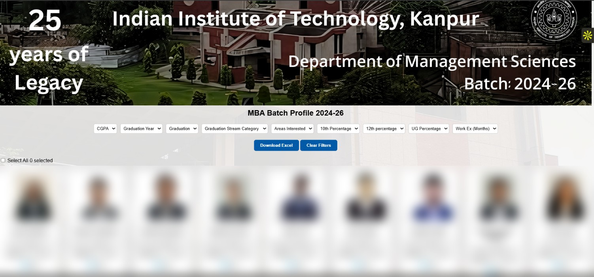
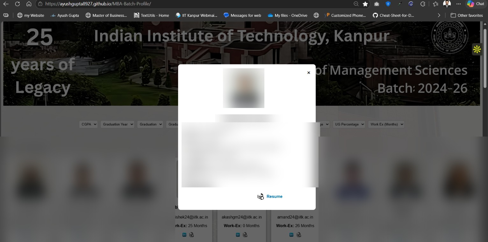
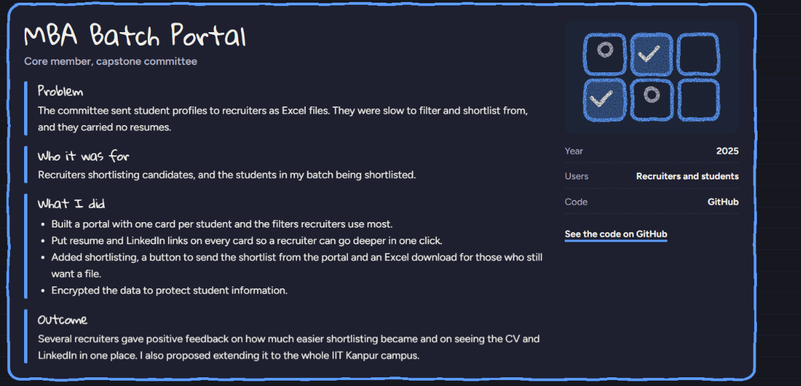

<div align="center">

# MBA Batch Profile Portal

### Turning a static student spreadsheet into a searchable, recruiter-friendly talent directory.

[](https://ayushgupta8927.github.io/MBA-Batch-Profile/)
[](https://github.com/ayushgupta8927/MBA-Batch-Profile)

**IIT Kanpur · Department of Management Sciences · MBA Batch 2024–26 · 2025**

</div>

---

## The idea

Recruiters were receiving student profiles as Excel files. While spreadsheets contained useful information, filtering candidates, comparing profiles and moving from a shortlist to a resume review took unnecessary effort. The files also did not present the batch's talent in a polished, consistent way.

The MBA Batch Profile Portal was created to make that process easier: a single web-based directory where recruiters can discover students using relevant filters, review profile information, and access supporting professional links.

It also gives the institute and the batch a more structured way to present the cohort's academic backgrounds, experience and areas of interest.

## At a glance

| | |
|---|---|
| **Project** | MBA Batch Profile Portal |
| **Institution** | IIT Kanpur – Department of Management Sciences |
| **Cohort** | MBA 2024–26 |
| **Year** | 2025 |
| **Primary users** | Recruiters, students and the institute |
| **Format** | Web-based student directory |
| **Repository** | HTML, CSS and JavaScript project structure |

## The experience

### 1. Browse the batch in one place

The portal presents students as individual profile cards rather than rows in a spreadsheet. Recruiters can scan the cohort and open a profile to see more detail.



### 2. Filter to find relevant candidates

The interface includes filters for key screening dimensions visible in the portal:

- CGPA
- Graduation year
- Graduation / stream category
- Areas of interest
- Class 10 and Class 12 percentages
- Undergraduate percentage
- Work experience (months)

This helps recruiters narrow a broad batch directory into a more relevant candidate set.

### 3. Open a richer student profile

A profile view brings key information together, including education, work experience, previous company, areas of interest and current CGPA. Resume and LinkedIn links provide a path to deeper evaluation.



### 4. Shortlist and export

The project case study describes selection controls for shortlisting candidates, sharing/sending a shortlist from the portal, and downloading an Excel file for recruiters who still need a spreadsheet workflow.



## How the workflow fits together


1. **Student data** is organised into structured profiles.
2. **Recruiters filter** the directory using screening criteria.
3. **Relevant candidates are selected** for a shortlist.
4. **Profiles are reviewed** with resume and LinkedIn links.
5. **The shortlist can be exported** for follow-up in Excel.

## What changed for each user

| User | Before | With the portal |
|---|---|---|
| Recruiters | Filter and compare candidates across Excel files | Search a visual directory, narrow profiles with filters and review links in one place |
| Students | Profile information was primarily represented in a spreadsheet | A more complete and consistent profile presentation |
| Institute / batch | A static file was the main way to share batch information | A central digital showcase for the cohort |

## My contribution

As a core member of the MBA batch and the Capstone Committee, I worked on translating a recurring placement-facing problem into a practical portal.

- Helped define the problem and the information recruiters need when screening candidates.
- Built the student-card browsing experience and recruiter-oriented filters.
- Brought resume and LinkedIn links closer to the profile-review flow.
- Worked on shortlist selection and Excel export functionality.
- Included data-protection considerations in the solution; the original case study describes encryption as a measure used to protect student information.
- Proposed extending the concept beyond the MBA batch to make student profiles easier to discover across the IIT Kanpur campus.

## Product decisions

| Decision | Why it matters |
|---|---|
| Card-based directory | Makes the batch easier to scan than a dense spreadsheet |
| Recruiter-oriented filters | Reduces the effort of finding relevant profiles |
| Detailed profile view | Keeps education and experience context together |
| Resume / LinkedIn links | Makes deeper evaluation accessible from the profile |
| Shortlist and Excel export | Supports both a digital workflow and recruiters who still work with spreadsheets |

## Technology and repository

The repository contains a lightweight front-end project:

- **HTML** — page structure
- **CSS** — layout and visual presentation
- **JavaScript** — client-side interactions
- **Data and static assets** — supporting folders for data, images, icons, resumes and watermark assets

Repository structure (as currently published):

```text
MBA-Batch-Profile/
├── data/
├── icons/
├── images/
├── resumes/
├── watermark/
├── index.html
├── script.js
└── style.css
```

## Try the portal

- **Live website:** https://ayushgupta8927.github.io/MBA-Batch-Profile/
- **Source code:** https://github.com/ayushgupta8927/MBA-Batch-Profile

Open the live portal to explore the batch directory, apply filters and inspect the profile layout.

## Outcome and future opportunity

The portal was designed to make recruiter shortlisting easier and to improve how the MBA cohort is represented online. Recruiter feedback, as captured in the project case study, was positive about the convenience of reviewing CV and LinkedIn information alongside student profiles.

A natural next step is to explore whether the same model can be adapted for a wider campus-wide talent directory, with appropriate ownership, consent and access controls.

## Privacy note

Student profiles can contain personal information, photographs, contact details and resumes. A public GitHub repository and a GitHub Pages site can expose files to anyone on the internet. Only publish student information and documents when the relevant people and institute have explicitly authorised public sharing. Remove or anonymise personal records, resumes and contact details before making the repository public, and review the `data/` and `resumes/` folders regularly.

---

<div align="center">

**Built to make talent easier to discover — and student profiles easier to present.**

[Live Portal](https://ayushgupta8927.github.io/MBA-Batch-Profile/) · [GitHub Repository](https://github.com/ayushgupta8927/MBA-Batch-Profile)

</div>
